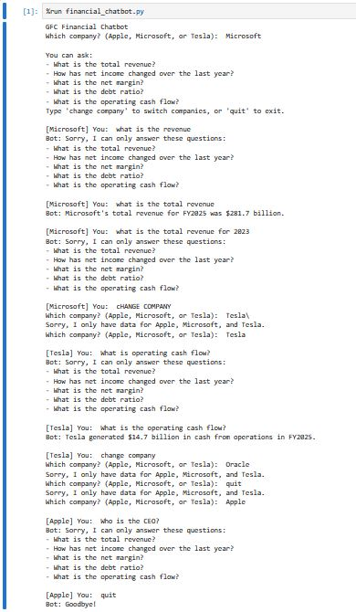

# GFC Financial Chatbot — BCG GenAI Job Simulation

A rule-based Python chatbot that answers financial questions about **Apple, Microsoft, and Tesla** using data I extracted by hand from their FY2023–FY2025 SEC 10-K filings.

Completed as part of the [BCG X GenAI Job Simulation](https://www.theforage.com/) on Forage, where I played a junior data scientist building a prototype financial-analysis assistant for a fictional client, Global Finance Corp. (GFC).



## What I did

| Task | Work | Tools |
|---|---|---|
| 1. Data extraction & analysis | Pulled 5 metrics × 3 companies × 3 fiscal years (45 values) from 10-K filings on SEC EDGAR, cross-checked all 45 against the source filings, and analyzed year-over-year trends | Excel, pandas, Jupyter |
| 2. Chatbot prototype | Built a command-line chatbot that loads the Task 1 dataset and answers 5 predefined questions, calculating ratios and YoY changes on the fly | Python, pandas |
| 3. Testing & documentation | Tested valid queries, invalid companies, unrecognized questions, and messy input (mixed case, extra spaces); documented limitations and next steps | Jupyter, Markdown |

## Questions the chatbot answers

| Question | What it calculates |
|---|---|
| What is the total revenue? | FY2025 total revenue |
| How has net income changed over the last year? | % change in net income, FY2024 → FY2025 |
| What is the net margin? | Net income ÷ revenue |
| What is the debt ratio? | Total liabilities ÷ total assets |
| What is the operating cash flow? | FY2025 cash from operating activities |

## How it works

- **Data:** loads `data/financial_data.csv` (USD millions) with pandas.
- **Matching:** normalizes input (case, spaces, trailing `?`) and routes it through `if`/`elif` rules.
- **State:** remembers the selected company until the user types `change company`.
- **Error handling:** re-prompts on unsupported companies and lists valid questions when a query isn't recognized.

## Run it

```bash
git clone https://github.com/mgurmessa/bcg-genai-financial-chatbot.git
cd bcg-genai-financial-chatbot
pip install -r requirements.txt
python financial_chatbot.py
```

Type `quit` at any prompt to exit.

## Project structure

```
bcg-genai-financial-chatbot/
├── financial_chatbot.py          # Task 2: the chatbot
├── data/
│   └── financial_data.csv        # Task 1: extracted 10-K figures
├── notebooks/
│   └── financial_analysis.ipynb  # Task 1: YoY trend analysis
├── docs/
│   ├── chatbot_documentation.md  # Design notes, limitations, next steps
│   └── demo_test_run.jpg         # Test session screenshot
└── requirements.txt
```

## Limitations and next steps

The prototype only accepts exact question wording, covers FY2025 (plus FY2024 for the net income comparison), and handles one company at a time. Fiscal years also end in different months for each company. The natural next steps are NLP-based intent matching so users can phrase questions freely, year selection and side-by-side comparisons, and a small Flask web interface with trend charts. Full details are in [docs/chatbot_documentation.md](docs/chatbot_documentation.md).

## Skills demonstrated

Financial statement analysis · SEC EDGAR research · Data validation · Python · pandas · Rule-based conversational logic · Input validation · Technical documentation

---
**Author:** Mikias Gurmessa — BCIS student, University of North Texas
